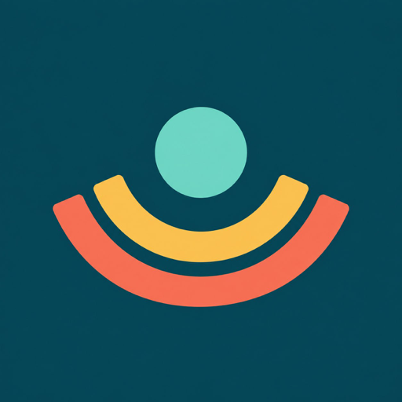
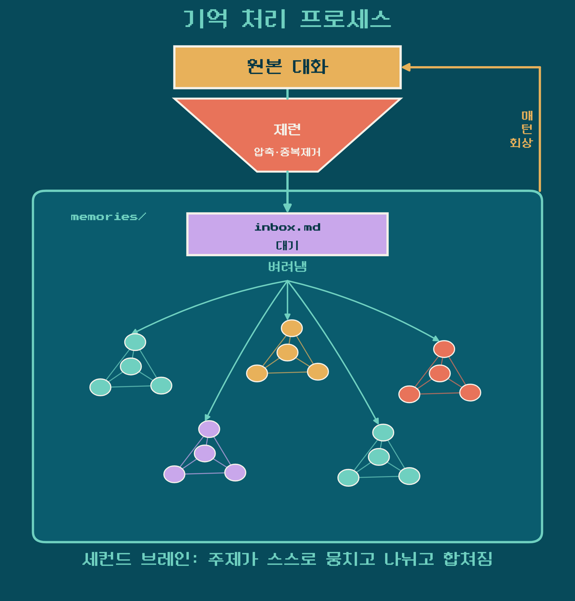

# dogany-agent (한국어)

[English README ->](README.md)

**도가니: 나를 이해하는 에이전트**

> 이 문서는 **도가니 v2.7.0 기준**입니다. 섹션마다 어느 버전부터 있는
> 기능인지 적어 두었습니다. *미리보기*는 v2.7.0에 들어 있지만 기본으로
> 꺼져 있는 기능이고, *v2.7 준비 중*은 아직 v2.7.0에 없는 기능입니다.

텔레그램으로 연락하는 나만의 Claude Code 에이전트. 내 기기(Mac, Linux,
Windows는 WSL2)에 살면서 기기가 켜져 있는 동안 늘 돌아가고, 나를 정말로
기억합니다 -- 장기기억, 정기 루틴, 스킬 시스템을 갖춘, 인스턴스마다 완전히
자립하는 개인 에이전트입니다. 배포 트리에는 개인 데이터가 전혀 없습니다.

## 설치 (2분)

*v2.6 또는 그 이전부터.*

    git clone https://github.com/coolcoolk/dogany-agent ~/.dogany/framework && cd ~/.dogany/framework && bash install.sh

마법사가 사전 요구사항을 확인하고(Claude Code가 없으면 대신 설치해 줍니다),
언어·타임존·봇 토큰(@BotFather에서 발급)을 차례로 물은 뒤 에이전트를
민트합니다. 자동시작 서비스와 이메일 계정 연결(전용 계정 권장)은 건너뛸 수
있는 선택 단계입니다.

텔레그램을 열고 봇에게 인사하세요. 봇은 소유자 없이 시작합니다: 일회용
클레임 코드를 출력하고, `/claim <코드>` 를 먼저 보낸 계정이 단독 소유자가
됩니다. 첫 대화가 곧 온보딩입니다 -- 에이전트가 자기 이름과 말투를 물어봅니다.

알아두면 좋은 것:

- 위처럼 `~/.dogany/` 아래에 클론하세요. macOS에서는
  문서/데스크탑/다운로드 폴더에 받지 마세요 -- 백그라운드 서비스가 읽지
  못해 설치기가 거부합니다.
- 아무것도 바꾸지 않고 전 과정을 미리 보려면:
  `bash install.sh --dry-run --lang ko`
- Windows는 WSL2가 필요합니다. 구현은 되었으나 검증하지 않은
  상태입니다.

## Why, How, What -- 그리고 나선

*처음부터 이어온 생각이고, 나선 그림은 v2.7.0에서 새로 넣었습니다.*

도가니는 일을 세 층으로 나눠 당신과 에이전트가 나눠 맡습니다.

- **Why는 당신 것입니다.** 방향은 당신이 정하고, 에이전트는 거기에 손대지
  않습니다.
- **What은 당신이 고르고 갖습니다.** 결과물은 에이전트가 만들지만, 무엇을
  남길지는 당신이 고릅니다. 고르다 보면 취향이 드러납니다.
- **How는 에이전트가 맡습니다.** 일을 직접 하고, 따라오는 인지 부담을
  대신 지고, 어떻게 됐는지 솔직하게 말합니다.

에이전트는 쓸수록 당신이 *무엇을* 원하는지뿐 아니라 *왜* 원하는지를
알아 갑니다. 새로 알게 된 이유는 이미 아는 이유들과 이어져서, 당신의
이유는 점점 넓어지는 그물이 됩니다. 시간을 따라 그 그물을 그리면 나선이
됩니다. 같은 주제를 한 층 위에서 다시 만나고, 그때마다 에이전트는 당신의
이유를 지난번보다 조금 더 압니다.

<!-- TODO(v2.7 README): docs/assets/spiral.png 그림은 아직 없습니다. 그림이
     생기기 전에는 공개하지 않습니다. -->

자기 나선에서 벗어나기는 쉽습니다. 한 걸음씩 떼어 보면 빠질 이유가 매번
그럴듯하고, 모아 놓고 봐야 이탈이 보입니다. 그래서 알아채는 장치를
넣었습니다. 매일 밤 그날 대화를 정리하고, 매주 주제별로 묶어 두는 정기
루틴이 그 주기를 잡아 줍니다.

## v2.7.0에서 새로 생긴 것

**답을 기다리는 질문을 놓치지 않습니다.**

- 버튼으로 물어본 질문이 뒤에 온 메시지에 밀려 올라가면, 에이전트가 그
  질문을 가장 아래로 다시 가져옵니다. 원래 질문에 답장 형태로 이어
  붙이니, 버튼을 누르거나 번호를 쳐서 바로 답할 수 있습니다.
- 에이전트가 대화 밖에서 보낸 알림이나 안내도 에이전트가 알고 있습니다.
  그 알림에 답장하면 무엇에 대한 답인지 압니다.

**기억이 지금 맞는 사실을 꺼냅니다.**

- 생활 기록에 적힌 내용(예: 라이프킷에 저장한 사람 정보)을 먼저 봅니다.
- 기억끼리 서로 다르면 더 최근 것을 따릅니다.
- 날짜가 지난 예정은 지난 일로 표시하고, 아직 유효한 것처럼 말하지
  않습니다.

**사용량 한도에 걸려도 메시지가 사라지지 않습니다.** Claude 사용량
한도에 닿으면 안내를 한 번만 보내고, 보낸 메시지는 한도가 풀리면 이어서
답합니다.

**중간에 끊긴 답도 받습니다.** 답하던 중에 멈추거나 시간이 다 되면,
그때까지 나온 쓸 만한 내용을 따로 한 메시지로 보내 드립니다.

**업데이트가 더 안전해졌습니다.** 확정한 결정은 업데이트나 재시작 뒤에도
그대로 남습니다. 같은 걸 다시 묻지 않고 정한 대로 이어서 합니다.

### v2.7.0 미리보기 (기본은 꺼짐)

v2.7.0에 들어 있지만 다듬는 동안 꺼 둡니다. 써 보고 싶은 기능이 있으면
에이전트에게 켜 달라고 하세요. 다시 끄고 싶을 때도 그렇게 말하면 됩니다.

- **나에게 맞는 에이전트 만들기.** 준비된 에이전트 중에 맞는 게 없으면,
  에이전트가 당신이 한 말만으로 새 에이전트를 같이 설계합니다. 만들기
  전에 설계를 먼저 보여 주고, 고칠 곳은 말로 고칠 수 있습니다.
- **이유를 기억하고, 짐작하기 전에 묻습니다.** 당신이 말한 이유를 기록해
  그물에 이어 두고, 짐작한 이유는 당신에게 확인한 뒤에야 당신의 이유로
  씁니다. 되돌리기 어렵거나 시행착오가 많은 일은 시작하기 전에 먼저
  묻습니다.
- **나선을 따라가는 하루 회고.** 하루에 한 번 메시지로 그날을 돌아봅니다.
  이유에 대한 질문은 하루 세 개까지, 한 번에 하나씩 묻고, 언제든 그만할
  수 있습니다. 일요일에는 하루 회고 대신 한 주 회고가 옵니다. 월말
  회고에 넣을 나선 그림은 아직 디자인 전입니다.
- **화면 조작 (macOS 14 이상).** 허락한 앱에서 에이전트가 화면을 보고
  클릭과 입력을 합니다. 지우기, 보내기, 결제, 덮어쓰기, 권한 바꾸기 전에는
  먼저 묻습니다. Linux는 아직 지원하지 않습니다.

### v2.7 준비 중

아직 v2.7.0에는 없습니다.

- **작업대에서 켜고 끄는 상시 감시.** 뒤에서 계속 도는 확인 작업을 고정된
  작업대 메시지에서 한 번 눌러 켜고 끕니다. 켜고 끄는 장치는 만들었지만,
  아직 감시를 제공하는 스킬이 없습니다.
- **Mac 앱 연결.** Mac 앱과 이어지기 위한 바탕은 깔았지만, 앱 연결 자체는
  아직 준비되지 않았습니다.
- **위험한 명령 막기.** 위험한 명령이나 파일 쓰기를 막는 검사는 지금은
  기록만 하고, 실제로 막지는 않습니다.

## 도가니가 하는 일

*v2.6 또는 그 이전부터.*

도가니는 쇠를 녹이는 그릇입니다. 그릇이 하는 네 가지가 이 제품이 하는
네 가지입니다.

- **Why. 무엇을 넣을지는 그릇이 정하지 않습니다.** 도가니는 자기가 녹일
  쇠를 고르지 않습니다. 방향은 당신이 정하고, 에이전트는 거기에 손대지
  않습니다.
- **How. 1500도를 견디는 건 쇳물이 아니라 벽입니다.** 열을 받는 쪽은
  언제나 그릇입니다. 방법을 짜서 실행하는 것도, 깨질 위험을 지는 것도
  에이전트 몫입니다.
- **What. 도가니는 녹인 것을 갖지 않습니다.** 부어냅니다. 결과물은
  에이전트가 만들지만, 고르고 갖는 사람은 당신입니다.
- **나선. 한 번 쓰고 버리는 그릇이 아닙니다.** 식으면 다시 쇠를 받고 또
  한 번 불에 들어갑니다. 그렇게 쓸수록 그릇이 커집니다. 덜어지는 것은 넣은
  쇠고, 커지는 것은 그릇입니다. 한국말에 "그릇이 크다"는 표현이 그대로
  있습니다.

## 이름

<h1 align="center">道 間 理</h1>

Dogany &nbsp;&nbsp; 도가니

理는 당신이 정한 방향, 道는 실제로 걸어온 길, 間은 도와 리 사이의
간극입니다. 에이전트가 일하는 자리가 그 간극입니다. 이름의 소리에 뜻을
맞춰 붙인 한자입니다.

> 리와 도 사이를 잇는다.

間이 道와 理 사이에 놓인 것은 우연이 아닙니다. 이름의 가운데 자리가
에이전트의 자리입니다.

## 구성 요소

*v2.6 또는 그 이전부터.*

스킬·모듈·킷은 능력을 조직하고, 에이전트팩은 에이전트의 정체를 정합니다.

- **스킬(skill)** -- 한 가지 동작: 리마인더 스킬은 밤 9시에 약 먹으라고
  알림 한 번을 보냅니다.
- **모듈(module)** -- 붙이는 능력: 식단기록 모듈은 "닭가슴살 200g"을
  칼로리로 계산해 라이프킷에 저장합니다. 능력이 늘어도 에이전트의 정체는
  그대로입니다. 단독으로 배달돼도 모듈입니다.
- **에이전트팩(agent pack)** -- 에이전트의 정체를 담은 묶음: 역할·지식·화법·일하는 방식.
  헬스트레이너 팩을 설치하면 에이전트가 루틴을 짜고 챙기는 운동 코치가 됩니다.
- **킷(kit)** -- 바탕이 되는 도메인의 데이터 규약. **라이프킷(LifeKit)**은
  일상(식사·운동·일정)을 담당합니다. 킷은 에이전트팩이 아닙니다.
- **설치 단위(install unit)** -- 킷·모듈·스킬·에이전트팩의 배포·설치·버전 단위를
  묶어 부르는 말입니다.

**에이전트**는 이 설치 단위들을 사용하는 실행 중인 인스턴스입니다.
코어 모듈은 킷 없이 에이전트에 직접 붙을 수도 있습니다. 에이전트팩은 정체를,
모듈은 능력을, 킷은 데이터의 바탕을 제공합니다.

## 메모리

*v2.6 또는 그 이전부터.*

당신의 프로필과 에이전트의 정체성은 매 턴 컨텍스트에 올라와 있습니다 --
같은 얘기를 두 번 할 필요가 없습니다. 나머지는 메시지를 보내는 순간
회수됩니다: 하이브리드 검색(키워드 + 시맨틱)이 기억 파일에서 상위 매칭을
찾아 모델이 읽기 전에 끼워 넣습니다. 시맨틱 검색은 로컬 Ollama + bge-m3
모델이 필요하며, 없으면 키워드 검색만으로 동작합니다. 기억 자체는 평범한
로컬 Markdown이고, 검색 인덱스는 선택 사항이며 언제든 재빌드할 수 있습니다.

쓰기도 그만큼 신중합니다. 매일 밤 그날의 대화가 인박스로 제련됩니다 --
잡음과 중복은 걷어내고, 시크릿은 리댁팅하고, 1년 뒤에도 가치 있는 사실만
남깁니다. 매주 인박스 항목이 토픽 파일로 분류됩니다. 에이전트는 기억
파일에 직접 쓰지 않으므로 볼트는 깔끔하고 감사 가능하게 유지됩니다.

밑에서 라우팅이 어떻게 도는지는 코드가 기준입니다.

## Windows

*v2.6 또는 그 이전부터.*

Windows에서는 WSL2가 필요합니다. 구현은 되었으나 검증하지 않은
상태입니다. 알아둘 플랫폼 한계 하나: WSL2에서는 재부팅 후 Windows에
로그인해야 에이전트가 돌아옵니다. 그 전에는 아닙니다.

## 로컬에서 직접 대화하기 (텔레그램 없이)

*v2.6 또는 그 이전부터.*

에이전트의 실체는 봇이 아니라 폴더입니다. 텔레그램은 입구 중 하나일 뿐,
터미널에서 `dogany`를 실행하면 같은 에이전트를 만납니다 -- 같은
정체성, 같은 기억, 같은 훅과 스킬:

    dogany

텔레그램과 CLI 대화는 별개 스레드지만 장기기억은 하나입니다. 야간 제련이
둘 다 읽기 때문에, 오늘 터미널에서 한 얘기를 내일 텔레그램이 기억합니다.
동시에 써도 안전합니다.

직접 폴더를 열어 대화하는 방법도 있습니다:

    cd ~/.dogany/main && claude

노트북 팁: 에이전트는 기기가 깨어 있는 동안만 동작합니다. 전원을 연결하고
시스템 잠자기를 꺼두세요. macOS: 시스템 설정 > 배터리 > 옵션 > "디스플레이가
꺼져 있을 때 전원 어댑터 연결 시 자동으로 잠자기 방지"를 켜거나(macOS 버전에
따라 메뉴 이름이 다를 수 있습니다) `sudo pmset -c sleep 0` 을 실행하세요.
외부 모니터를 연결한 클램셸 모드가 아닌 이상 덮개를 닫으면 기기가 잠자기에
들어가니 덮개를 닫지 마세요. 화면 잠자기(화면만 꺼짐)는 무관합니다.

## 업데이트

*`/update`는 v2.6부터.*

- 텔레그램에서 `/update` 를 보내세요. 프레임워크, 킷, 에이전트팩까지 지금
  올릴 수 있는 업데이트를 한 화면에 보여주고, 고른 것을 버튼으로 적용합니다.
  같은 킷을 쓰는 에이전트들은 함께 올라갑니다.
- 에이전트에게 업데이트해 달라고 하면 `/update` 로 안내합니다.
- `/update` 가 없는 버전(v2.6 이전)에서 올라오는 경우에는 `dogany update` 를
  한 번 실행하세요. 그다음부터는 `/update` 를 쓰면 됩니다.

에이전트는 릴리즈 노트가 딸린 발행 버전만 설치합니다. 기억, 정체성, 개인
데이터는 변경되지 않습니다. 내장 스킬을 직접 수정했다면 업데이트가 교체
전에 백업해 두며, 지속적으로 커스터마이즈하려면 스킬을 자기 이름으로 복사해
그쪽을 편집하세요.

## 데이터와 프라이버시

*v2.6 또는 그 이전부터.*

- 봇은 소유자 잠금입니다: 첫 접촉에서 클레임하면 다른 누구도 당신의
  에이전트에 접근할 수 없습니다.
- 모든 개인 데이터 -- 기억, 기록, 세션, 토큰 -- 는 인스턴스 디렉터리에
  있으며 레포나 git 히스토리에 절대 들어가지 않습니다.
- 레포에는 코드와 빈 구조만 있습니다.

## 내부 구조

*v2.6 또는 그 이전부터.*

- **`agents/.template/`** 이 청사진입니다: `install.sh`가 여기서 에이전트를
  민트합니다(기본값 `~/.dogany/main`). 완전 자립 복사본이라 인스턴스의
  어떤 것도 이 레포를 되가리키지 않으며, 어디에 있든 그대로 동작합니다.
- **`skills/`** 에는 모든 에이전트가 처음부터 갖는 내장 스킬이 있습니다:
  리마인더, 기억검색, 스케줄링, 온보딩 등.
- 생활 기록 능력(식사·일정·인간관계 등)은 별도 킷인 라이프킷(레포
  공개 레포 `dogany-kit-life`, 자체 버전)에서 옵니다. 민트 후 설치되며, 에이전트에게
  켜 달라고 하면 킷 스킬을 모두 켜고 킷의 첫 설정으로 넘겨줍니다. 이후 킷
  업데이트는 `/update` 에 나옵니다.
- 각 에이전트의 `bridge/`는 공식 `claude-agent-sdk` 기반의 자립형
  Telegram <-> Claude 브릿지입니다.

기여자 수준의 상세 -- 민트 역학, 훅 배선, 기억 라우팅, 에이전트팩 게이팅 -- 는
별도 문서로 두지 않습니다. 코드를 보시면 됩니다.

## 라이선스

*지금 조건은 v2.6.0부터.*

2.6.0부터 Dogany는 [PolyForm Strict License 1.0.0](LICENSE)과 Dogany 확장
허가([LICENSE](LICENSE) 마지막 절)를 따릅니다:

- 비상업적 용도로만 쓸 수 있습니다.
- Dogany 자체를 고치거나 재배포할 수 없습니다.
- [`packs/CONTRACT.md`](packs/CONTRACT.md)에 적힌 인터페이스에 붙는 킷·모듈·
  스킬·에이전트팩은 직접 만들어 원하는 조건으로 배포할 수 있습니다.

2.6.0 이전 버전은 Apache License 2.0으로 배포되었고 그 조건이 그대로
유지됩니다. 동봉된 텔레그램 브릿지는 MIT 라이선스입니다([NOTICE](NOTICE) 참고).
