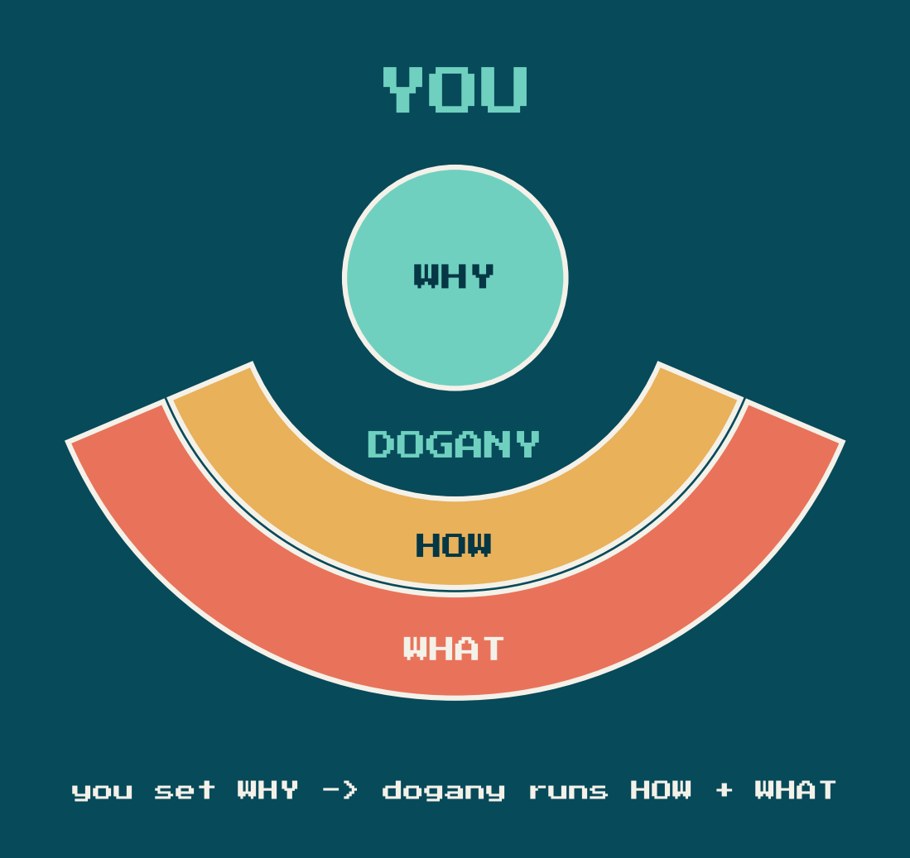
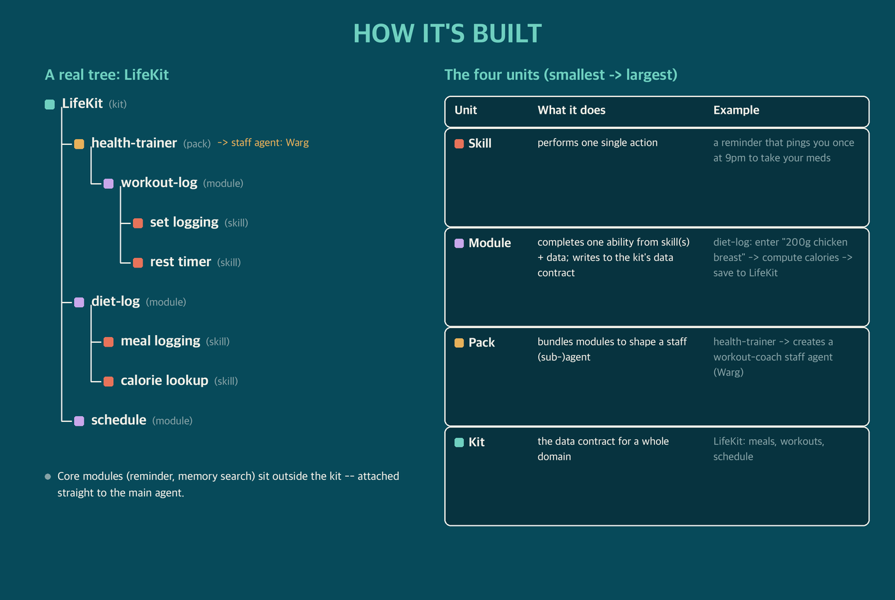
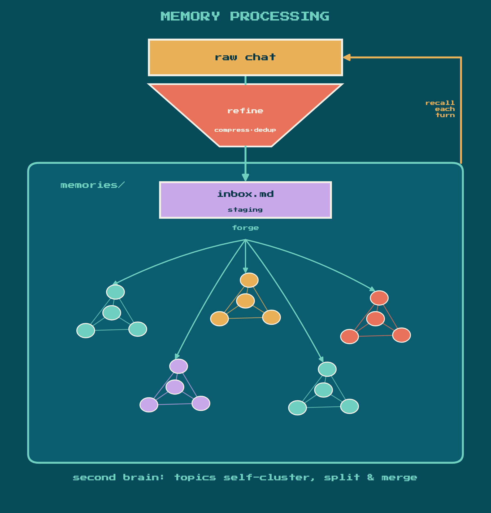

# dogany-agent

[한국어 안내 -> README-ko.md](README-ko.md)

**Dogany: an agent that understands you**

An agent framework built on the Golden Circle and the spiral

Your own Claude Code agent, reachable over Telegram. It lives on your own
machine (Mac, Linux, or Windows via WSL2), runs whenever the machine is on,
and actually remembers you: long-term memory, scheduled routines, and a
skill system -- fully self-contained per instance, with zero personal data
baked in.

## Install (2 minutes)

    git clone https://github.com/coolcoolk/dogany-agent ~/.dogany/framework && cd ~/.dogany/framework && bash install.sh

The wizard checks prerequisites (it installs Claude Code for you if
missing), asks your language, timezone, and a bot token from @BotFather,
then mints your agent. Autostart and an email account (a dedicated one is
recommended) are optional steps you can skip.

Open Telegram and greet your bot. It starts unowned: it prints a one-time
claim code, and the first account to send `/claim <code>` becomes its sole
owner. The first conversation is onboarding -- the agent asks what to be
called and how to speak.

Good to know:

- Clone under `~/.dogany/` as shown. On macOS, do NOT clone into
  Documents/Desktop/Downloads -- background services cannot read those
  folders (the installer refuses such paths).
- To preview every step without changing anything:
  `bash install.sh --dry-run --lang en`
- Windows needs WSL2. The support is implemented but unverified.

## The Golden Circle and the spiral

The Golden Circle is three layers: Why, How, What. Dogany splits those three
between you and your agent. You set the Why. The direction of your life is
decided and owned by you, and your agent does not touch it. Your agent takes
the How. It proposes the method, runs it, and carries the cognitive load that
comes with it. The What is made by your agent too, but choosing it and owning
it is yours, and the choosing is what surfaces your taste. Growth shows up in
retrospectives and numbers.

The spiral says those three layers do not run once and stop. A spiral turns
around a centre and rises. Something that turns in place is not a spiral. You
meet the same subject again one layer up. The problem is how easily anyone
drops out of their own spiral. Taken one step at a time, every reason to
leave it is defensible, and only the sum is drift. So the noticing has to be
built. The nightly pass that smelts the day's conversations and the weekly
pass that files them are what give the turn its period.

## What Dogany does

A crucible is the vessel you melt metal in. The four things the vessel does
are the four things this product does.

- **Why. The vessel does not choose the charge.** A crucible never picks what
  goes into it. You set the direction, and your agent does not touch it.
- **How. What withstands 1500°C is the wall, not the melt.** The heat is
  always taken by the vessel. Proposing the method and running it is the
  agent's side, and so is the risk of cracking.
- **What. A crucible does not keep what it melted.** It pours it out. Outputs
  are made by your agent, and choosing them and owning them is yours.
- **Spiral. It is not single-use.** It cools, takes a new charge, and goes
  back into the fire. Used that way, the vessel grows. What is subtracted is
  the charge, and what grows is the vessel. Korean has a living idiom for it,
  *그릇이 크다*, said of a person whose vessel is large.

## The name

<h1 align="center">道 間 理</h1>

Dogany &nbsp;&nbsp; 도가니

*Dogany* is Korean for crucible. Re-split into three characters it reads 理,
the aim you set, then 道, the path you actually walked, then 間, the gap
between 道 and 理. That gap is where your agent works. The characters are
ours, assigned to the sound of the name.

間 sits between 道 and 理 by design: the middle slot of the name is the
agent's slot.

## How it's built

Everything is one containment relation, smallest unit outward:

- **Skill** -- one action: a reminder skill pings you once at 9pm to take
  your meds. Skills are the atoms everything larger is assembled from.
- **Module** -- one ability, from skills plus data: the diet-log module
  turns "200g chicken breast" into calories saved in LifeKit.
- **Pack** -- modules plus knowledge, bundled to shape a staff agent: a
  health-trainer pack becomes a workout coach that plans your routines and
  checks in on you.
- **Kit** -- the data contract for a whole domain, so every module and pack
  in it shares one schema: **LifeKit** covers daily life -- meals, workouts,
  schedule. (Kits for other domains are planned.)

Two shortcuts sit outside the nesting: a core module (reminders, memory
search) attaches straight to the main agent, skipping the kit; and
installing a pack creates a staff agent under the main agent -- your one
and only body, which holds the identity and memory and equips the kit.

## Memory

Your profile and the agent's identity are in context on every turn -- you
never re-explain yourself. Everything else is recalled the moment you send
a message: a hybrid search (keyword + semantic) over your memory files
splices the top matches in before the model reads it. Semantic search needs
local Ollama with the bge-m3 model; without it, keyword search still works.
Memory itself is plain local Markdown -- the search index is optional and
rebuildable anytime.

Writing is just as deliberate. Nightly, the day's conversations are
distilled into an inbox -- noise and duplicates dropped, secrets redacted,
only facts worth keeping a year from now. Weekly, inbox items are filed
into topic files. The agent never writes memory files directly, so the
vault stays clean and auditable.

The code is the reference for how the routing works underneath.

## Windows

Windows needs WSL2. The support is implemented but unverified. One
platform limit to know: under WSL2 the agent comes back after a reboot
only once you sign in to Windows, not before.

## Talk to it locally (no Telegram needed)

The agent is the folder, not the bot. Telegram is just one door; running
`dogany` in any terminal opens a local session with the SAME agent -- same
identity, memory, hooks, and skills:

    dogany

Telegram and CLI conversations are separate threads but share one long-term
memory: the nightly consolidate pass reads both, so tomorrow's Telegram chat
remembers today's terminal session. Running both at once is safe.

If you prefer to open the agent directory manually instead:

    cd ~/.dogany/main && claude

Tip for laptops: the agent runs only while the machine is awake. Keep it on
AC power and prevent system sleep. On macOS: System Settings > Battery >
Options > turn on "Prevent automatic sleeping on power adapter when the
display is off" (exact label may vary by macOS version), or run
`sudo pmset -c sleep 0`. Do not close the lid unless an external display is
connected (clamshell mode keeps the machine awake). Display sleep is fine --
only system sleep stops the agent.

## Keeping it up to date

- Ask your agent in Telegram: "update yourself"
- Or run locally: `dogany update`

The agent pins itself to the latest published release tag -- you only ever
receive versioned releases with release notes -- and refreshes its built-in
skills. Your memories, identity, and personal data are never touched. If
you edited a built-in skill, the update backs your copy up before replacing
it; to customize durably, copy the skill under your own name and edit that.

## Data and privacy

- The bot is owner-locked: claim it on first contact, and no one else can
  reach your agent.
- All personal data -- memories, records, sessions, and tokens -- lives in
  your instance directory and never enters the repo or its git history.
- The repo ships code and empty scaffolding only.

## Under the hood

- **`agents/.template/`** is the blueprint: `install.sh` mints your agent
  from it (default `~/.dogany/main`) as a fully self-contained copy --
  nothing in the instance points back at this repo, so it keeps working
  wherever it lives.
- **`skills/`** holds the built-in skills every agent starts with:
  reminders, memory search, scheduling, onboarding, and more.
- Life-tracking abilities (meals, appointments, relationships, ...) come
  from the separate LifeKit pack (repo `dogany-lifekit`), installed after
  mint -- ask your agent to enable them.
- Each agent's `bridge/` is a self-contained Telegram <-> Claude bridge
  built on the official `claude-agent-sdk`.

Contributor-level detail -- mint mechanics, hook wiring, memory routing,
pack gating -- is not documented separately; read the code.

## License

[Apache 2.0](LICENSE).
