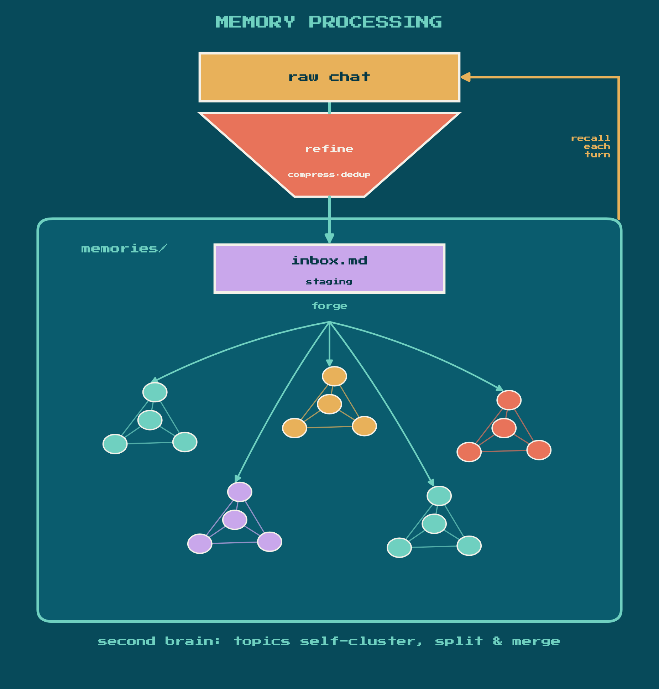

# dogany-agent

[한국어 안내 -> README-ko.md](README-ko.md)

**Dogany: an agent that understands you**

> This README is written as of **Dogany v2.7.0**. Each section says which
> version it arrived in. Features marked *preview* ship in v2.7.0 but are
> off by default; features marked *coming in v2.7 (in progress)* are not
> in v2.7.0 yet.

Your own Claude Code agent, reachable over Telegram. It lives on your own
machine (Mac, Linux, or Windows via WSL2), runs whenever the machine is on,
and actually remembers you: long-term memory, scheduled routines, and a
skill system -- fully self-contained per instance, with zero personal data
baked in.

## Install (2 minutes)

*Since v2.6 or earlier.*

    git clone https://github.com/coolcoolk/dogany-agent ~/.dogany/framework && cd ~/.dogany/framework && bash install.sh

The wizard checks prerequisites (it installs Claude Code for you if
missing), asks your language, timezone, and a bot token from @BotFather,
then mints your agent. Autostart and an email account (a dedicated one is
recommended) are optional steps you can skip.

Browser automation (~684 MB) and Cua Driver (macOS 14+) install by default, including on `/update`; scripted installs/updates can use `--no-browser` / `--no-computer-use`.

Open Telegram and greet your bot. It starts unowned: it prints a one-time
claim code, and the first account to send `/claim <code>` becomes its sole
owner. The first conversation is onboarding -- the agent asks what to be
called and how to speak.

Good to know:

- Clone under `~/.dogany/` as shown. On macOS, do NOT clone into
  Documents/Desktop/Downloads -- background services cannot read those
  folders (the installer refuses such paths).
- To preview every step without changing anything:
  `bash install.sh --dry-run --lang en`
- Windows needs WSL2. The support is implemented but unverified.

## Why, How, What -- and the spiral

*The idea behind every version; the drawing is new in v2.7.0.*

Dogany splits the work between you and your agent along three layers:

- **Why is yours.** You set the direction. Your agent does not touch it.
- **What is yours to choose and own.** Your agent makes the results; you
  pick what to keep, and the picking shows your taste.
- **How is the agent's.** It does the work, carries the cognitive load that
  comes with it, and tells you honestly how it went.

Over time your agent learns *why* you want things, not only what. Each
reason it learns connects to the ones it already knows, so your reasons
form a growing net. Drawn over time, that net is a spiral: you meet the
same subject again, one layer up, and the agent already knows more of your
reasons than last time.

<!-- TODO(v2.7 README): docs/assets/spiral.png is not drawn yet. Do not
     publish the README until it exists. -->

It is easy to drift off your own spiral. One step at a time, every reason
to leave it sounds fine; only the sum is drift. So the noticing is built
in: a nightly pass distills the day's conversations and a weekly pass files
them, which gives the turn its rhythm.

## New in v2.7.0

**Your agent keeps track of open decisions.**

- An open question with buttons no longer gets buried. When later messages
  push it up, your agent brings it back to the newest message, linked to
  the original, and you can still answer by tapping or by typing the
  number.
- Your agent sees the reminders and notices it sent you outside the
  conversation, so when you reply to one, it knows what you are replying
  to.

**Memory recalls the current fact, not an old one.**

- What your life records say (for example a person's details in LifeKit)
  comes first.
- When two memories disagree, the newer one wins.
- A plan whose date has passed is marked as out of date instead of being
  repeated as if it still held.

**Usage limits don't lose your message.** When you hit your Claude usage
limit, you get one notice. Your message waits and is answered once the
limit resets.

**Interrupted answers still arrive.** If a reply is stopped or times out
midway, the useful part it already had reaches you as its own message.

**Safer updates.** Decisions you confirmed survive an update or restart.
The agent resumes from what you decided instead of asking again.

### Preview in v2.7.0 (off by default)

These ship in v2.7.0 but stay off until they are finished. To try a preview
feature, ask your agent to turn it on (and to turn it off again).

- **Make an agent that fits you.** When no ready-made agent fits what you
  asked for, your agent designs a new one with you, built only from your
  own words. You see the design before anything is made, and you can
  correct it.
- **The agent keeps your reasons and asks before guessing.** It records
  the reasons you give, links them into the net, and checks with you
  before treating a guess as your reason. Before work that is hard to undo
  or needs a lot of trial and error, it asks you first.
- **Daily retro with the spiral.** One message a day looks back on the
  day. Your agent asks about at most three reasons per day, one at a
  time, and you can stop at any point. On Sundays a weekly recap replaces
  the daily one. The spiral picture in the monthly retro is not designed
  yet.
- **Computer use (macOS 14 or later).** Your agent can see the screen and
  click and type in apps you allow. Before anything that deletes, sends,
  pays, overwrites or changes permissions, it asks you first. Linux is not
  supported yet.

### Coming in v2.7 (in progress)

Not in v2.7.0 yet:

- **Standing watches on the workbench.** Checks that keep running in the
  background, switched on and off with one tap from the pinned workbench
  message. The switch is built; no skill provides a watch yet.
- **Connection to the Mac app.** The groundwork for a companion Mac app is
  in place; the app connection itself is not ready.
- **Safety checks on commands.** Checks that stop risky commands and file
  writes currently only observe; they do not block anything yet.

## What Dogany does

*Since v2.6 or earlier.*

A crucible is the vessel you melt metal in. The four things the vessel does
are the four things this product does.

- **Why. The vessel does not choose the charge.** A crucible never picks what
  goes into it. You set the direction, and your agent does not touch it.
- **How. What withstands 1500°C is the wall, not the melt.** The heat is
  always taken by the vessel. Proposing the method and running it is the
  agent's side, and so is the risk of cracking.
- **What. A crucible does not keep what it melted.** It pours it out. Outputs
  are made by your agent, and choosing them and owning them is yours.
- **Spiral. It is not single-use.** It cools, takes a new charge, and goes
  back into the fire. Used that way, the vessel grows. What is subtracted is
  the charge, and what grows is the vessel. Korean has a living idiom for it,
  *그릇이 크다*, said of a person whose vessel is large.

## The name

<h1 align="center">道 間 理</h1>

Dogany &nbsp;&nbsp; 도가니

*Dogany* is Korean for crucible. Re-split into three characters it reads 理,
the aim you set, then 道, the path you actually walked, then 間, the gap
between 道 and 理. That gap is where your agent works. The characters are
ours, assigned to the sound of the name.

間 sits between 道 and 理 by design: the middle slot of the name is the
agent's slot.

## How it's built

*Since v2.6 or earlier.*

Skills, modules, and kits organize capabilities. Agent packs define who an agent is.

- **Skill** -- one action: a reminder skill pings you once at 9pm to take
  your meds.
- **Module** -- an attachable capability: the diet-log module turns
  "200g chicken breast" into calories saved in LifeKit. A module adds an
  ability while the agent keeps its identity.
- **Agent pack** -- the agent's identity bundle: its role, knowledge, voice, and
  way of working. Installing a health-trainer agent pack makes the agent a
  workout coach that plans your routines and checks in on you.
- **Kit** -- the base data contract for a domain. **LifeKit** covers daily
  life -- meals, workouts, schedule. A kit is separate from an agent pack.
- **Install unit** -- the umbrella term for a kit, module, skill, or agent pack as a
  unit of delivery, installation, and versioning.

An **agent** is the running instance that uses these install units. Core
modules can attach directly to an agent without a kit. Agent packs shape the
agent's identity; modules extend its abilities; kits provide the data base.

## Memory

*Since v2.6 or earlier.*

Your profile and the agent's identity are in context on every turn -- you
never re-explain yourself. Everything else is recalled the moment you send
a message: a hybrid search (keyword + semantic) over your memory files
splices the top matches in before the model reads it. Semantic search needs
local Ollama with the bge-m3 model; without it, keyword search still works.
Memory itself is plain local Markdown -- the search index is optional and
rebuildable anytime.

Writing is just as deliberate. Nightly, the day's conversations are
distilled into an inbox -- noise and duplicates dropped, secrets redacted,
only facts worth keeping a year from now. Weekly, inbox items are filed
into topic files. The agent never writes memory files directly, so the
vault stays clean and auditable.

The code is the reference for how the routing works underneath.

## Windows

*Since v2.6 or earlier.*

Windows needs WSL2. The support is implemented but unverified. One
platform limit to know: under WSL2 the agent comes back after a reboot
only once you sign in to Windows, not before.

## Talk to it locally (no Telegram needed)

*Since v2.6 or earlier.*

The agent is the folder, not the bot. Telegram is just one door; running
`dogany` in any terminal opens a local session with the SAME agent -- same
identity, memory, hooks, and skills:

    dogany

Telegram and CLI conversations are separate threads but share one long-term
memory: the nightly consolidate pass reads both, so tomorrow's Telegram chat
remembers today's terminal session. Running both at once is safe.

If you prefer to open the agent directory manually instead:

    cd ~/.dogany/main && claude

Tip for laptops: the agent runs only while the machine is awake. Keep it on
AC power and prevent system sleep. On macOS: System Settings > Battery >
Options > turn on "Prevent automatic sleeping on power adapter when the
display is off" (exact label may vary by macOS version), or run
`sudo pmset -c sleep 0`. Do not close the lid unless an external display is
connected (clamshell mode keeps the machine awake). Display sleep is fine --
only system sleep stops the agent.

## Keeping it up to date

*`/update` since v2.6.*

- Send `/update` in Telegram. It lists every update available for your
  agents -- the framework, kits and agent packs -- on one screen and applies
  the one you pick with a button. Agents that share a kit are updated
  together.
- If you ask your agent to update itself, it points you to `/update`.
- Coming from a version without `/update` (before v2.6)? Run `dogany update`
  once; after that, use `/update`.

The agent only installs published, versioned releases with release notes.
Your memories, identity, and personal data are never touched. If you edited
a built-in skill, the update backs your copy up before replacing it; to
customize durably, copy the skill under your own name and edit that.

## Data and privacy

*Since v2.6 or earlier.*

- The bot is owner-locked: claim it on first contact, and no one else can
  reach your agent.
- All personal data -- memories, records, sessions, and tokens -- lives in
  your instance directory and never enters the repo or its git history.
- The repo ships code and empty scaffolding only.

## Under the hood

*Since v2.6 or earlier.*

- **`agents/.template/`** is the blueprint: `install.sh` mints your agent
  from it (default `~/.dogany/main`) as a fully self-contained copy --
  nothing in the instance points back at this repo, so it keeps working
  wherever it lives.
- **`skills/`** holds the built-in skills every agent starts with:
  reminders, memory search, scheduling, onboarding, and more.
- Life-tracking abilities (meals, appointments, relationships, ...) come
  from LifeKit, a separate kit (public repo `dogany-kit-life`) with its own versions,
  installed after mint. Ask your agent to turn it on: it turns every kit
  skill on and hands over to the kit's own first-run setup. Later kit
  updates show up in `/update`.
- Each agent's `bridge/` is a self-contained Telegram <-> Claude bridge
  built on the official `claude-agent-sdk`.

Contributor-level detail -- mint mechanics, hook wiring, memory routing,
agent pack gating -- is not documented separately; read the code.

## License

*Current terms since v2.6.0.*

From version 2.6.0, Dogany is released under the
[PolyForm Strict License 1.0.0](LICENSE) together with the Dogany Extension
Permission (the last section of [LICENSE](LICENSE)):

- Noncommercial use only.
- No changes to Dogany itself, and no redistribution of it.
- You may write and distribute your own kits, modules, skills, and agent
  agent packs that plug into the interfaces described in
  [`packs/CONTRACT.md`](packs/CONTRACT.md), on terms of your choosing.

Versions before 2.6.0 were released under the Apache License 2.0 and remain
under those terms. The bundled Telegram bridge is MIT-licensed; see
[NOTICE](NOTICE).
